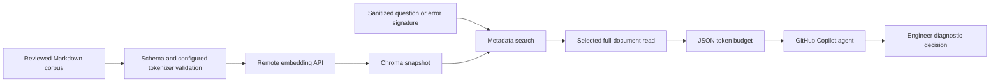

# Architecture and limits

## Storage lifecycle

Long references live outside the corpus under `reference_documents/`. A short
indexed card's `source_file` links to the full Markdown; ingestion verifies the
path and records its hash. Only cards are embedded, once each. Source edits
refresh index metadata while unchanged card vectors are reused. `read-reference`
verifies the source hash and returns the complete source or an explicitly selected
ATX heading section under its output budget. Source sections are not embedded.

`load_corpus` validates every knowledge Markdown file, rejects duplicate IDs,
empty corpora, malformed metadata, symlinks and oversized files. The embedder
then measures full text with the configured tokenizer. All
files must pass before a replacement index is created.

Each build creates a fresh cosine collection. Batches of 32 bound vector processing
and database writes; unchanged vectors are retrieved from the current snapshot.
Only one vector per ID is added. A SHA-256 content hash detects edits. The model
name, endpoint, query prefix, tokenizer, normalization and format version identify
embedding compatibility.
Model changes rebuild vectors and prohibit cross-model queries.

A file lock serializes readers and writers. The writer flushes and atomically
replaces the small manifest only after all records are stored. Failures before
publication delete the incomplete collection, leaving the old index intact. A
hard crash may leave an orphan; a later successful rebuild removes obsolete
collections. Snapshot IDs prevent reads using outdated search selections. This
is a local single-host design, not a distributed transaction or HA database.
Back up the source corpus; the index is derived and rebuildable. During rebuild,
disk space may approach two indexes and readers wait, with a 60-second timeout.

## Retrieval and context

Semantic search selects metadata and distances; full Markdown is fetched only
for selected IDs. Filters combine document kind, component, framework and review status.
Kind is derived from `references/` or `troubleshooting/` and enforced before ranking.
Index metadata upgrades rebuild the snapshot while reusing unchanged vectors. A
cosine distance cutoff removes weak matches; the default 0.65 is an initial
retrieval setting that owners should calibrate, never a correctness probability.
No-match retrieval returns an empty result rather than an invented answer.

`read` returns complete files or fails when JSON exceeds its budget. `context`
returns as many complete selected files as fit, with an omission count. Tokens
are measured over the serialized output using `cl100k_base`; other Copilot
models may tokenize differently. The toolkit cannot enforce Copilot's complete
context window, token billing, or adherence to prompt instructions. Skills
limit turns and use checkpoints; the engineer remains responsible for review.

The corpus loader currently holds all Markdown text in memory during ingestion.
Vector encoding is batched, but ingestion is not streaming. File limits keep
individual runbooks small. Monitor repository size, rebuild time and disk usage;
for very large multi-team knowledge bases move ingestion to a managed pipeline
and offer tenant-authorized retrieval behind a service. A cloned local index is
appropriate for an authorized bounded corpus, not unlimited central knowledge.

## Trust and privacy

Embedding runs remotely. Indexed Markdown and search inputs are sent to the
configured embedding API. Installation contacts package registries; Chroma
anonymized telemetry is disabled. Copilot chat and tool outputs
are subject to your organization's Copilot configuration. Do not paste secrets.
The CLI masks common credential patterns before embedding, but masking is best
effort and cannot remove all private identifiers or protect already-pasted chat.
Use stdin/file input to avoid shell interpretation of pasted errors. Query strings
are not persisted by the toolkit; shell history and editor history are separate.

Repository membership controls which documents can be cloned. Chroma's local
files are not encrypted by this toolkit; use workstation access controls and disk
encryption. Filtering does not enforce tenant isolation. Agent tool restrictions
and prompts are advisory; IAM and scoped approved platform operations enforce
actual authorization. The toolkit contains no direct GDP mutation functions.

## References

[Chroma clients](https://docs.trychroma.com/reference/python) distinguish ephemeral,
persistent and HTTP clients. The remote embedding adapter uses the
[OpenAI-compatible embedding format](https://developers.openai.com/api/docs/guides/embeddings).
Model, endpoint, input limits and query prefix are configured in `config.toml`.
GDP-specific topology and operating procedures must be supplied by the platform team.
