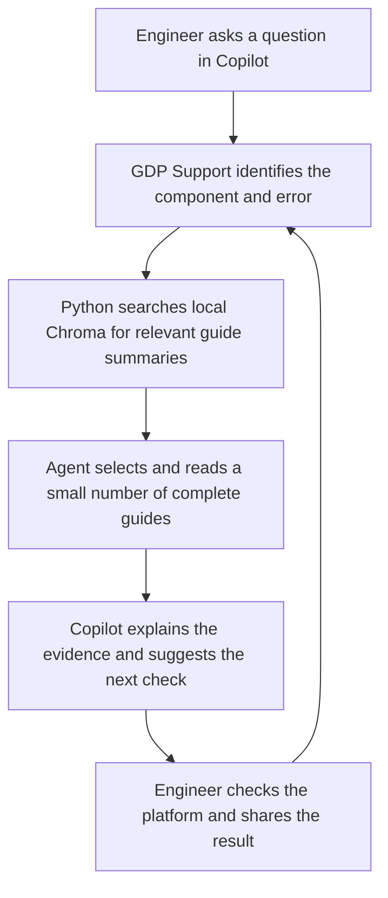

# Beginner's guide

This repository helps data engineers ask questions about GDP and investigate
errors using GitHub Copilot and your team's documented knowledge.

Think of it as a small support library with a helpful librarian:

- **Markdown guides** are the books: platform explanations and troubleshooting steps.
- **Chroma** is the searchable catalogue, stored locally on your computer.
- **Python scripts** build the catalogue and find relevant guides.
- **Copilot agents** use those guides to explain an issue and suggest the next check.
- **Skills** tell the agents how to search and troubleshoot consistently.

The included guides are **illustrative examples**. Your platform team must replace
or approve them using your actual GDP architecture and operating procedures.

Choose one of the two journeys below. If this is your first visit, complete
[first-time setup](#3-first-time-setup) before running commands.

For ready-to-run examples, use the [approved local test pack](../examples/approved-testing/README.md):
two references, two troubleshooting guides and eight evaluation questions in
a separate test corpus/index. Test approval does not imply production applicability.

## Journey 1: Contributor guide — add and validate knowledge

Platform and framework teams maintain the evidence that engineers will retrieve.
Start with verified platform documentation or a sanitized, resolved incident.
Use **GDP Knowledge Maintainer** to help draft changes; the owning team reviews
accuracy and applicability.

### A. Contribute documentation references

Use `knowledge/references/` for platform explanations, how-to guidance, migration
mappings and supported framework capabilities. These answer questions even when
there is no error.

1. Search existing references for the same topic. Amend the existing file if its
   scope is unchanged, keeping its stable ID. Create a new file and unique ID for
   a new concept or an independently applicable version.
2. Copy [the reference template](reference-template.md) into `knowledge/references/`.
   Replace all placeholders with actual ownership, version and evidence; use
   `status: draft` until owner review.
3. Write a direct answer, applicability, prerequisites, a short example and
   limitations. Keep one focused concept per file so the entire Markdown fits
   the model's configured token input limit.
   For a long reference, keep the complete source in `reference_documents/` and
   put a short card with `source_file` in `knowledge/references/`. The configured token
   limit applies to that card; the full source is fetched after selection.
4. Add realistic question variants to the evaluation YAML, expecting that
   reference's ID. Complete the verification steps below.

For **“What are CDP equivalent tech stacks in GDP?”**, an owner could contribute
`knowledge/references/cdp-gdp-ingestion-mapping.md` and separate focused files
for transformation and consumption. Document actual CDP technology, GDP
counterpart, version/scope and migration differences. A counterpart may require
behavior or configuration changes; “equivalent” must not imply identical behavior.
Clarify which CDP platform/component is meant when that affects the mapping.

For **“Does transformation support only SQL or PySpark DataFrames too?”**, an
owner could contribute `knowledge/references/transformation-supported-apis.md`.
State whether each API is supported for the deployed framework version, how jobs
are submitted, and relevant limitations. General Spark capabilities do not
establish what your GDP framework supports.

The repository includes `REF-003`, now a short card linking to the full CDP/GDP
mapping in `reference_documents/cdp-gdp-equivalence.md`, and `REF-004`, which
records missing SQL/PySpark capability evidence. Owners must maintain applicability
and reconcile any older knowledge-gap statements with newly supplied facts.
See [long references](long-references.md) before adding a manual larger than
the model's input limit.

### B. Contribute or amend a troubleshooting guide

Use `knowledge/troubleshooting/` for a reported failure and its diagnostic and
resolution procedure.

1. Look for the same error family and applicable version. For an improved
   diagnostic or resolution, amend that file and preserve its ID. For a new error
   family, copy [the runbook template](runbook-template.md) into a new file and
   assign a unique ID.
2. Include recognizable error phrases, symptoms, discriminating read-only checks,
   the verified cause, scoped resolution, rollback, verification and escalation.
   Remove secrets and tenant payloads.
   Put sanitized real platform/framework messages under `## Exact error messages`,
   including the emitting log/API/UI and version. Keep codes and stable wording;
   replace private or dynamic values with placeholders. If the issue emits no
   error, capture its actual status instead. See [authoring examples](authoring.md#titles-summaries-and-exact-error-evidence).
3. Update version applicability and review metadata. Changed operational guidance
   needs owning-team review; use `draft` while that review is pending.
4. Add several sanitized phrasings to the evaluation YAML, expecting the runbook ID.

Example: amend `ING-002` after a verified schema-mismatch incident identifies a
better check for source type changes. A different authentication error belongs
in its relevant authentication guide or a new focused runbook, rather than being
added to the schema guide.

### C. Verify with the evaluation YAML

Add cases to `evaluation/retrieval.yaml`. For example, the existing references
and runbook can be tested using cases like:

```yaml
# Append entries under the existing cases: list.
- id: cdp-ingestion-equivalence
  query: "What is the GDP counterpart of our CDP ingestion stack?"
  expected_id: REF-003
  kind: reference
- id: transformation-dataframe-capability
  query: "Does transformation support PySpark DataFrame operations or only SQL?"
  component: transformation
  expected_id: REF-004
  kind: reference
- id: schema-type-change-followup
  query: "Ingestion broke after a source column changed type"
  component: ingestion
  expected_id: ING-002
  kind: troubleshooting
```

`REF-003` retrieves a card whose linked mapping must be read before answering;
`REF-004` still retrieves a capability evidence gap. Keep exact error
messages and plain-language variations, plus no-match cases for unrelated queries.

After editing knowledge Markdown, run from the repository root:

```bash
.venv/bin/python scripts/query.py validate --embedding
.venv/bin/python scripts/ingest.py
.venv/bin/python scripts/query.py evaluate --format table
```

Windows PowerShell:

```powershell
.venv\Scripts\python.exe scripts\query.py validate --embedding
.venv\Scripts\python.exe scripts\ingest.py
.venv\Scripts\python.exe scripts\query.py evaluate --format table
```

If you changed **only** `evaluation/retrieval.yaml`, rerun evaluation directly;
the index does not need rebuilding. The JSON form remains available:

```bash
.venv/bin/python scripts/query.py evaluate
```

Inspect the table: clarification cases should find the intended references;
incident cases should find the intended troubleshooting guide; unrelated queries
should return no matches. Investigate failures using [Section 11](#11-evaluate-different-question-phrasings).
The evaluator checks IDs/ranks and no-match behavior; it does not test whether
Copilot correctly classifies a question or produces a correct answer.

Also try representative questions in Copilot and verify intent, source choice,
citations and answer style. Submit the Markdown and evaluation changes through
your team's review process. After approval/merge, users pull updates and rerun
ingestion. Changes to dependencies require bootstrap again. Agent/skill changes
are repository instructions and do not need embedding.

## Journey 2: User guide — find answers and troubleshoot

Data engineers consume the reviewed knowledge. Complete setup, open the repository
in VS Code and choose **GDP Support**. After pulling knowledge updates, rerun
ingestion to refresh your local index.

### A. Find how-to, capability and migration answers

Ask the question and include the framework/version or migration source when known.
No job error is required. For example:

> What are CDP equivalent tech stacks in GDP platform?

The agent treats this as a migration/architecture clarification, searches for
mapping references, and answers with a cited comparison of documented counterparts
and differences. It may ask which CDP component or version you mean. If the
mapping is missing, it identifies the gap and asks the owner for evidence.

> Does transformation framework support only SQL or PySpark DataFrame operations also?

The agent treats this as a capability clarification and selects the transformation
capability reference. A documented answer should state support by version,
entry points and limitations. It should not infer DataFrame support from the
existence of a Spark troubleshooting guide. With the currently shipped sample
knowledge, the correct response is that framework-owner evidence is missing.

For a how-to question such as “How do I submit a transformation job?”, the agent
should retrieve the applicable usage reference and explain its documented
prerequisites and steps. Missing commands or configuration must not be invented.

### B. Investigate a failure

For Spark jobs pending before execution, approved runbook **TRN-003** checks the
queue in `application.yaml`, observed running drivers and resource headroom,
then escalation. The agent populates [the generic support ticket](escalation-template.md) from
the checks performed and their outcomes. Users and platform/framework engineers
refer to the same draft for every issue. See [queue diagnostic details](spark-pending-ticket.md)
for this particular runbook. Exact queue field
paths and pod labels must match your deployed configuration.

Paste a concise sanitized error and describe the framework/version and recent
changes. For example:

> My ingestion job failed with schema contract mismatch after a column type changed.

The agent selects the relevant troubleshooting guide, checks applicability and
suggests one read-only diagnostic check with expected outcomes. Share the result
so it can refine the hypothesis. A resolution should include scope, required
authorization, rollback and execution/data verification.

### How agents and skills choose the journey

| Request intent | Preferred evidence | Skills | Answer style |
| --- | --- | --- | --- |
| How-to, architecture, capability or migration clarification | `knowledge/references/` | `gdp-retrieval` | Direct cited explanation, supported versions, steps or comparison; state gaps |
| Reported error or failed behavior | `knowledge/troubleshooting/`, with references for background when needed | `gdp-retrieval` and `gdp-troubleshoot` | Evidence-based hypothesis, one diagnostic check at a time, then scoped resolution and verification |
| Add or update knowledge | Verified reference material or resolved incident | `gdp-knowledge-maintenance` | Reviewable Markdown changes and retrieval evaluation cases |

Routing depends on the question's intent, not simply words such as “SQL” or
“Spark”. Mixed questions can require both references and a runbook. Search
results include each document's source path, which the agent uses to identify
its purpose. Agents use `--kind reference` or `--kind troubleshooting`, enforced
in Chroma before ranking, then select sources within the retrieval budgets.
Rerun ingestion once after adopting this version to populate category metadata.

The agent instructions guide this selection; actual Copilot behavior needs
manual verification. The sections below explain setup, retrieval mechanics,
context limits and evaluation in more detail.

## 1. What happens when you ask a question?

Suppose you ask: “My ingestion job failed with a schema mismatch. What should I check?”



The agent first searches for matching guides without loading their full text.
For this example, it can find `ING-002`, the schema mismatch guide. It then reads
the selected guide and explains its applicability. A useful first check is to
compare the source schema with the configured contract and last successful run.

You report what you found, and the agent uses that result to decide the next
step. The intended workflow is a conversation with one diagnostic decision at
a time. The Python scripts retrieve evidence; Copilot generates the explanation.

## 2. Where everything lives

| Location | What it does | Who usually uses it |
| --- | --- | --- |
| `.github/agents/` | Defines the five Copilot agents and their responsibilities | Engineers choose agents; maintainers edit them |
| `.github/skills/` | Gives agents instructions for retrieval, troubleshooting and knowledge maintenance | Agents and maintainers |
| `.github/copilot-instructions.md` | Shared repository instructions for Copilot | Agents and maintainers |
| `knowledge/references/` | Explains platform concepts and framework contracts | Platform team |
| `reference_documents/` | Holds full-length references linked by indexed cards; fetched after selection | Platform team |
| `knowledge/troubleshooting/` | Stores error symptoms, checks, resolution and verification guides | Platform team |
| `scripts/bootstrap.py` | Creates the Python environment and installs dependencies | Everyone during setup |
| `scripts/ingest.py` | Reads knowledge Markdown and builds or refreshes the search index | Everyone during setup and after updates |
| `scripts/query.py` | Searches the index and returns selected evidence | Agents; engineers checking retrieval |
| `src/gdp_support/` | Implements validation, embeddings, storage and commands | Python developers |
| `tests/` | Checks that retrieval and updates behave correctly | Maintainers |
| `docs/` | Contains setup, authoring and operational documentation | Everyone |
| `.github/workflows/ci.yml` | Defines automated checks for GitHub Actions | Maintainers |
| `pyproject.toml` and `uv.lock` | Declare packages and record dependency versions | Setup tools and maintainers |

Setup also creates `.venv/`, the project's Python environment, and `.gdp/`, the
local persistent index. These generated folders are excluded from Git. You can
rebuild the index from the Markdown source files.

Only Markdown under `knowledge/` is indexed. This beginner's guide and other
files under `docs/` are documentation for using the repository.

## 3. First-time setup

Install Git, Python **3.11–3.13**, VS Code and GitHub Copilot with agent mode.
The examples below use Python 3.12. You also need network access to install
packages and call the configured remote embedding API. Set its API key first
(see [configuration](../README.md#remote-embedding-and-storage-configuration)).

Open a terminal, clone your team's repository and enter its directory. Replace
the placeholders with your team's actual URL and folder name:

```text
git clone <your-repository-url>
cd <your-repository-folder>
```

Run the setup command for your operating system.

**macOS/Linux:**

```sh
python3.12 scripts/bootstrap.py --ingest
```

**Windows PowerShell:**

```powershell
py -3.12 scripts/bootstrap.py --ingest
```

This command creates `.venv/`, installs the required packages, calls the
configured remote embedding API, and indexes the knowledge guides.
You do not need to activate the environment. The commands below use its Python
interpreter directly. If `uv` is installed, setup uses the committed dependency
lock; otherwise it uses pip with compatible package ranges.

Check that the index exists:

**macOS/Linux:**

```sh
.venv/bin/python scripts/query.py status
```

**Windows PowerShell:**

```powershell
.venv\Scripts\python.exe scripts\query.py status
```

A successful command prints JSON describing the current index and document count.
JSON is structured text meant to be easy for the agent and scripts to read.
The current sample corpus contains thirteen documents.

## 4. Use it in Copilot

1. Open the cloned repository folder in VS Code.
2. Open Copilot Chat and select **GDP Support** in the agent picker.
3. Enable terminal tools so the agent can run the local retrieval scripts.
4. Ask a question or paste a sanitized error with relevant context.
5. Follow the suggested diagnostic check and report its result.

For example:

> My ingestion job reports a schema contract mismatch. It started after a source
> column type changed. What should I check first?

Helpful context includes the component, framework, deployed version, concise
error message, and recent changes. Remove passwords, tokens, customer data and
private identifiers before pasting. Avoid pasting a whole log when a short error
signature will describe the issue.

| Agent | When to choose it |
| --- | --- |
| GDP Support | Start here for general questions or an unfamiliar error |
| GDP Ingestion | Investigate source connectors, schema contracts or checkpoints |
| GDP Transformation | Investigate transformation issues such as dbt or Spark failures |
| GDP Consumption | Investigate data access or freshness issues |
| GDP Knowledge Maintainer | Draft a guide from a sanitized, verified incident |

The agents offer guidance; this repository has no direct functions for changing
your GDP platform. Review any proposed operational change and follow your team's
authorization process.

## 5. Try retrieval yourself

You can test the local search without starting a Copilot conversation.

**macOS/Linux:**

```sh
.venv/bin/python scripts/query.py search --query "ingestion schema mismatch" --component ingestion --top-k 3
.venv/bin/python scripts/query.py read ING-002
```

**Windows PowerShell:**

```powershell
.venv\Scripts\python.exe scripts\query.py search --query "ingestion schema mismatch" --component ingestion --top-k 3
.venv\Scripts\python.exe scripts\query.py read ING-002
```

`search` returns up to three matching summaries, document IDs and metadata.
`read` returns the complete selected Markdown. In the agent workflow, reads also
use the search result's snapshot ID to ensure the index has not changed between
searching and reading.

The `context` command combines search and full-document retrieval:

```sh
.venv/bin/python scripts/query.py context --query "ingestion schema mismatch" --component ingestion --top-k 2 --budget 1800
```

On Windows, replace `.venv/bin/python` with `.venv\Scripts\python.exe`.
Here `--top-k 2` asks for up to two matches, and `--budget 1800` limits the
returned JSON to 1,800 tokens using the toolkit's output tokenizer. Documents
that cannot fit are omitted whole. This budget does not limit the entire
Copilot conversation.

## 6. What is an embedding, and why use Chroma?

An **embedding** is a list of numbers representing text. Similar meanings tend
to have similar numerical representations. This lets a question such as
“source credentials expired” find a guide about authentication failures even
when the wording differs.

During ingestion, the remote embedding API converts each complete knowledge
Markdown file into **one embedding**. Chroma stores that embedding, the original
Markdown and metadata such as ID, component, owner and review status.

During search, the model also embeds your concise question. Chroma compares it
with the document embeddings to find relevant candidates. Similarity helps find
evidence; it does not prove that a guide applies or that a diagnosis is correct.

Each file must fit within the model's **configured token input limit**, including its
metadata. Tokens are small pieces of text, not necessarily whole words. An
oversized file fails validation; the script does not split or silently shorten
it. Keep each guide focused on one issue and check its size with
`validate --embedding`.

### What if my reference is longer than the configured token limit?

Keep it outside the indexed corpus in `reference_documents/`. Create one short
reference card under `knowledge/references/` with the same stable ID and metadata,
a useful summary/search description, and `source_file: your-full-reference.md`.
The full source is not embedded, so it can exceed the model's limit. This repository
now uses that layout for your CDP/GDP comparison. The original source is preserved.

After validating and ingesting, the agent searches the card and fetches the source:

```bash
uv run scripts/query.py validate --embedding
uv run scripts/ingest.py
uv run scripts/query.py read-reference REF-003 --list-sections
uv run scripts/query.py read-reference REF-003 --section "1. Technology Stack Comparison" --budget 1800
```

For a source that fits the output budget, omit `--section` to read it completely.
A section read is explicitly marked partial and never produces another embedding.
The full document can be up to 2MB, while each returned source or section must fit
the chosen output budget. If it does not fit, add narrower meaningful headings
and re-ingest. Full-source edits also require re-ingestion to refresh the recorded
hash, even if the card did not change. See [the complete workflow](long-references.md).

## 7. How the repository keeps context small

The agent searches short summaries first, then reads only selected complete
guides. Retrieval commands enforce output budgets. Skills instruct the agent
to limit searches and reads and keep a short record of findings and the next
check instead of carrying full logs forward.

Here is what that means for a specific incident. Suppose an engineer reports:

> The ingestion job failed with “schema contract mismatch.” A source column
> changed from integer to string yesterday.

The following is an illustrative walkthrough using the sample guides in this
repository. Search ranking can vary with the question; the example is not a
claim that this incident happened on your GDP platform.

### Step 1: Find candidates without reading every guide

The agent uses a short error signature to search:

```sh
.venv/bin/python scripts/query.py search --query "ingestion schema contract mismatch" --component ingestion --top-k 3 --budget 1200
```

On Windows, use `.venv\Scripts\python.exe` instead of `.venv/bin/python`.

Chroma searches the indexed document embeddings. The response exposes only
metadata for up to three matching documents, not their complete Markdown.
For example, one candidate could be:

| Metadata field | Example value |
| --- | --- |
| ID | `ING-002` |
| Title | Ingestion schema contract mismatch |
| Summary | Schema drift, incompatible type or missing source field. |
| Component | ingestion |
| Framework | connector |
| Status | example |
| Source | troubleshooting/ingestion-schema.md |

The real JSON also includes ownership, review date, version, content hash,
distance and a snapshot ID. The agent compares these previews with the reported
error and selects the relevant guide. Authentication and Spark guides need not
enter the conversation if their previews do not apply.

“Search summaries first” describes what the agent receives. The underlying
similarity search uses embeddings of the **complete Markdown files**, not
separate summary embeddings.

### Step 2: Read the selected complete guide

The agent reads `ING-002` using the snapshot ID returned by search:

```sh
.venv/bin/python scripts/query.py read ING-002 --snapshot gdp-RETURNED-SNAPSHOT --budget 1800
```

Replace `gdp-RETURNED-SNAPSHOT` with the actual returned value. This check avoids
reading from a different index if someone rebuilds it between search and read.

The response now includes the complete schema-mismatch Markdown, including its
metadata, symptoms, diagnosis, resolution, rollback, verification and escalation.
It does not include every other guide. The agent must disclose that this source
has `example` status and confirm its applicability before giving operational advice.

Based on this guide, the next diagnostic question could be:

> Compare the sanitized source schema with the configured contract and the last
> successful run. Which column changed, and what are its old and new types?

### Step 3: Respect the retrieval budgets

There are two different kinds of limits:

| Limit | What it controls | How it is applied |
| --- | --- | --- |
| `--top-k 3` | Number of candidate results requested | Search returns at most three matches, possibly fewer |
| Search `--budget 1200` | Size of that command's JSON output | The CLI removes matches if needed to fit the budget |
| Read `--budget 1800` | Size of the full-document JSON output | The CLI returns complete documents or fails; it never cuts a guide mid-section |
| Skill allowance of 4,000 retrieval tokens per diagnostic turn | Combined retrieval output the agent should request in that turn | Agent instructions require it to plan within this allowance |
| Skill limit of three searches and three document reads per diagnostic turn | Repeated evidence gathering | Agent instructions require it to stop or narrow the investigation |

For example, a search budget of 1,200 plus a read budget of 1,800 allows up to
3,000 output tokens across those two calls. The actual outputs may be smaller.
The agent should account for output already received before making another call;
the CLI does not maintain a shared 4,000-token counter across commands.

If a read cannot fit its budget, the agent can request fewer documents or read
one selected ID. With the combined `context` command, complete documents that
do not fit are omitted and counted in `omitted_for_budget`. Neither command
silently truncates a guide to make it fit.

These output tokens are measured using `cl100k_base`. They are separate from
the embedding model's configured token input limit and may differ from the tokenizer
used by your selected Copilot model.

### Step 4: Keep a short checkpoint for the next decision

Suppose the engineer checks the schemas and reports that `customer_id` changed
from integer to string, while the configured contract still expects integer.
The agent can retain a compact conversational checkpoint such as:

```text
Component/framework: ingestion / connector; deployed version still needed
Error signature: schema contract mismatch
Observed: customer_id changed integer → string; contract expects integer
Evidence: ING-002, example; applicability requires owner validation
Hypothesis: source type change is incompatible with the current contract
Checked: source schema compared with contract and last successful run
Next check: establish whether records committed before the failure
```

This records the facts, uncertainty, source and next decision. The agent can
continue from that checkpoint without repeatedly quoting the entire error log
or reloading every guide. It should preserve details that affect correctness,
such as whether records were committed before a retry.

A checkpoint is a short conversation summary, not another embedding or an
automatically saved incident file. It also does not erase messages already in
Copilot's history; it reduces what the agent repeats and carries forward in its
working summary. The skill instructions guide this behavior, while the CLI
enforces each retrieval command's output budget.

Adding more guides therefore does not require sending the whole knowledge
library to Copilot. These controls bound retrieved evidence; they cannot enforce
Copilot's full context window, billing or compliance with instructions.

## 8. Persistent storage versus in-memory storage

The default saves the index under `.gdp/`. That allows one command to ingest
documents and later commands to search the same index, including after you
restart your computer.

True in-memory mode builds, searches and discards the index in one process:

```sh
.venv/bin/python scripts/query.py --memory context --query "schema mismatch" --component ingestion
```

Use the Windows interpreter path on Windows. A separate in-memory ingestion
command cannot leave an index for another process to search. Persistent mode
is the practical default for everyday use.

Embeddings run remotely: indexed Markdown and search inputs are sent to the
configured embedding API. Copilot questions and retrieved tool outputs can also
be sent to Copilot's configured service.

## 9. Refresh after your team updates the repository

Pull updates, then rebuild your local index:

**macOS/Linux:**

```sh
git pull
.venv/bin/python scripts/ingest.py
```

**Windows PowerShell:**

```powershell
git pull
.venv\Scripts\python.exe scripts\ingest.py
```

Ingestion reuses embeddings for unchanged files, embeds changed or new files,
and removes deleted documents from the new index. Invalid updates leave the
previous index usable. If dependencies changed, rerun the bootstrap command
before ingestion.

## 10. Add a troubleshooting guide

This is normally the platform or framework team's responsibility.

1. Start from [the runbook template](runbook-template.md).
2. Create a focused Markdown file under `knowledge/troubleshooting/`.
3. Add the required metadata: a unique stable ID, title, summary, component,
   framework, owner, status, quoted review date and applicable version.
4. Explain symptoms, diagnostic checks, resolution, rollback, verification and escalation.
5. Start unreviewed guidance as `draft`; have the owning team validate it before marking it `approved`.
6. Validate the documents and rebuild the index.

**macOS/Linux:**

```sh
.venv/bin/python scripts/query.py validate --embedding
.venv/bin/python scripts/ingest.py
```

**Windows PowerShell:**

```powershell
.venv\Scripts\python.exe scripts\query.py validate --embedding
.venv\Scripts\python.exe scripts\ingest.py
```

See [authoring rules](authoring.md) for exact metadata requirements and
[contribution guidance](../CONTRIBUTING.md) for the review workflow. Keep tenant
logs, credentials and local database files out of commits.

## 11. Evaluate different question phrasings

After adding or updating cases in `evaluation/retrieval.yaml`, save the file and
run this command from the repository root:

```bash
.venv/bin/python scripts/query.py evaluate
```

This uses your already-ingested index and prints a JSON report. Editing only the
evaluation YAML does **not** require ingestion. If you also changed Markdown under
`knowledge/`, run `scripts/ingest.py` first so the checks use the updated guides.

For an easier-to-read results table, run:

```bash
.venv/bin/python scripts/query.py evaluate --format table
```

Windows PowerShell:

```powershell
.venv\Scripts\python.exe scripts\query.py evaluate --format table
```

The table shows the expected guide, returned IDs and distances, rank, pass/fail
and suggested follow-up. A positive case passes if the intended guide appears
within its configured top results. A no-match case passes only when no guides
are returned. Exit code 1 means at least one case failed, not that setup failed.

### Sample results and what to refine

The following historical baseline was measured on the original ten sample
guides before the category references and pending-job guide were added.
Rerun evaluation for current results: the current dataset also tests the four
clarification/troubleshooting examples with category filters.

| Case | Expected | Actual returned IDs, in order | Expected rank | Result | What to refine |
| --- | --- | --- | --- | --- | --- |
| schema-error-message | ING-002 | ING-002, ING-003, ING-001 | 1 | PASS | No refinement indicated |
| schema-plain-language | ING-002 | ING-002, ING-003, ING-001 | 1 | PASS | No refinement indicated |
| schema-missing-field | ING-002 | TRN-001, ING-002, ING-001 | 2 | PASS | Review connector/missing-field wording and component context if ING-002 should rank first |
| auth-error-message | ING-001 | ING-001, ING-003, ING-002 | 1 | PASS | No refinement indicated |
| network | PLT-001 | PLT-001, REF-002, REF-001 | 1 | PASS | No refinement indicated |
| unrelated-question | No matches | CON-002, TRN-001, REF-001 | — | FAIL | Cake question should return no guides; calibrate rejection |
| unrelated-with-component | No matches | ING-002, ING-003, ING-001 | — | FAIL | Violin question should return no guides even with an ingestion filter; calibrate rejection |

The category-filtered checks on the current thirteen-document corpus produced:

| Question | Category filter | Expected guide | Rank | Result | Answer boundary |
| --- | --- | --- | --- | --- | --- |
| CDP equivalent tech stacks in GDP? | reference | REF-003 | 1 | PASS | Fetch the linked mapping and check applicability/caveats |
| SQL only or PySpark DataFrames too? | reference | REF-004 | 1 | PASS | Explain missing framework capability evidence |
| Spark transformation failed with out-of-memory? | troubleshooting | TRN-002 | 1 | PASS | Distinguish driver/executor failure and memory/skew causes |
| Spark transformation pending without running? | troubleshooting | TRN-003 | 1 | PASS | Establish submission, driver allocation and task state |

All 15 positive cases passed; the two unrelated-query cases still failed
(15/17 overall). The reference cases pass because they retrieve the intended
reference documents/cards, not because retrieval alone verifies platform facts.
REF-003 now links to the full supplied mapping; the agent must fetch it and
reconcile retained caveats. REF-004 still documents missing capability evidence.

For a failed **expected-match** case, verify that the guide applies, check its
wording and the case's filters, distance cutoff and budget, then update the
relevant guide using verified terminology. Re-ingest and rerun evaluation.

For a failed **no-match** case, the unrelated question is receiving misleading
candidates. Review distance-based rejection using a broader set of positive
and negative questions. A lower maximum distance rejects more candidates but
can also reject useful matches. Validate both groups before changing settings,
and apply chosen settings consistently in agent searches and evaluations.
Do not remove negative cases or alter expected answers just to make checks pass.

See [the retrieval evaluation walkthrough](retrieval-evaluation.md) for dataset
fields, metrics and maintenance guidance.

## 12. Common beginner questions

**Do I need to write Python to use this?** No. Engineers run setup and use the
Copilot agents. Maintainers mainly write Markdown; Python changes are needed
when changing retrieval behavior.

**Does cloning make it ready immediately?** Run bootstrap and ingestion after
cloning. Copilot also needs access to the opened repository and terminal tools.

**Why did search return nothing?** The issue may be undocumented, filters may
be too narrow, or matches may be too weak. Try a clearer short signature. Treat
missing evidence as a reason to ask the owner rather than invent a resolution.

**Why does approved-only search return nothing?** All shipped knowledge files
are examples. Approved-only retrieval needs guides your platform team has reviewed
and marked `approved`.

**Why was my document or error rejected?** Its metadata may be invalid or its
text may exceed the embedding model's limit. Keep guides focused and reduce
errors to a sanitized signature. See [setup troubleshooting](setup-troubleshooting.md).

**What should I read next?** Use [the README](../README.md) for command summaries,
[the tool contract](tool-contract.md) for advanced flags, and
[architecture](architecture.md) to understand implementation details and limits.
